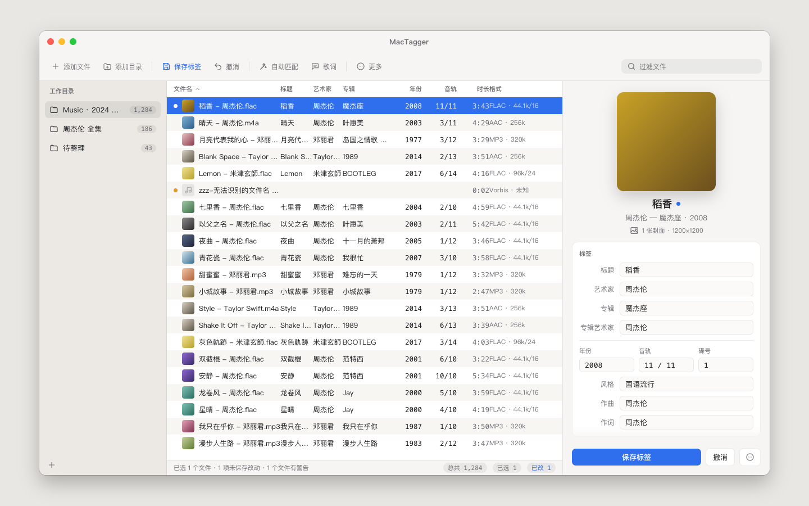
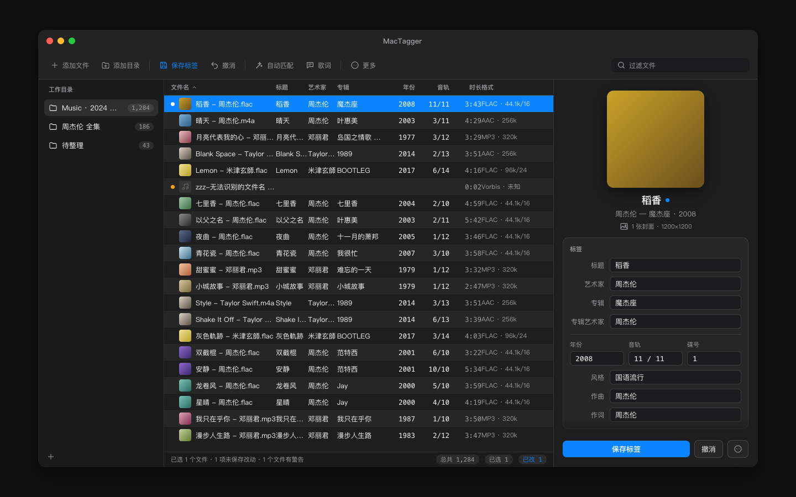

# MacTagger

**macOS 原生的音乐标签编辑器**——批量改标签、在线匹配元数据与封面、下载带翻译的歌词，对 TF 卡等可移动存储友好。



> **关于本项目**：MacTagger 是一个**独立的 clean-room 重写**。它的功能规格受 Windows 版「音乐标签 MusicTag」（作者 vinlxc，闭源免费软件）启发，但**不包含其任何代码、资源或数据**，也**不是**其官方版本或移植版，与原作者无任何关联。

## 功能

- **17 种格式**：FLAC、APE、WAV、AIFF、WavPack、TTA、MP3、MP4、M4A、Ogg Vorbis、Musepack、Opus、WMA、DSF、DFF、AAC、TAK。其中 16 种已用真实样本实测读、写、封面全部可用；TAK 目前 TagLib 2.3 不识别，暂不支持。标签引擎为 [TagLib](https://taglib.org/)，畸形文件只报错、不崩溃。
- **在线数据源**（可插拔，单个源失效不影响其他源）：网易云音乐、QQ 音乐、酷狗、酷我、iTunes（16 个地区可选，带地区回退）、MusicBrainz、Cover Art Archive。每次搜索都显示各源的结果条；连续超时的源会自动熔断，到期后自动恢复。
- **自动匹配**：逐首匹配，或**专辑模式**（按文件夹整碟匹配，对齐曲目数和时长）；复核表按专辑卡片展示「原 → 新」，可以逐个文件、逐个字段决定写不写。
- **歌词**：搜索、批量下载、编辑（时间轴调整、查找替换），**支持合并翻译**（Live 版没有翻译时，从录音室版按行移植）；可以写进标签，也可以另存为 LRC、增强 LRC、TXT 或 SRT。
- **撤消**：手动保存、清除、自动匹配、歌词、重命名、整理都能撤回；另有标签历史库。
- **TF 卡友好**：识别可移动存储后自动串行写入，并按卡的持续速度自适应节流；写入前会预估要整文件重写多少个文件。
- **预留填充**：第一次不得不整文件重写时，顺手预留一段填充，之后改标签、换封面都能原地写入。
- **封面**：从网络搜索、调整分辨率和压缩、从同专辑的其他文件取图，还支持**文件夹封面**（cover.jpg 或 folder.jpg，音频文件一个字节都不改）。
- **简繁转换**：基于 [OpenCC](https://github.com/BYVoid/OpenCC)，可转标签或文件名；在线结果可统一转成简体。
- **重命名与整理**：文件名和标签互转（模板加正则）；按标签整理到文件夹（模板决定目录层级，跨卷时先复制并校验，可整批撤消）。
- 浅色和深色外观；文件可以拖拽导入；大库先列出文件，标签在后台懒加载。

<details>
<summary>深色外观（设计稿）</summary>



</details>

## 系统要求

- macOS **14.4** 或更高版本（Apple Silicon；Intel Mac 需要把 `project.yml` 里的 `/opt/homebrew` 改成 `/usr/local`）
- 从源码构建需要 Xcode（开发与验证使用 Xcode 27.1）与 Homebrew

## 从源码构建

```bash
# 1. 依赖（只在编译期需要；构建出的 App 已经嵌入 dylib，运行时不依赖 Homebrew）
brew install taglib opencc xcodegen

# 2. 生成 Xcode 工程（xcodeproj 不进仓库，由 project.yml 生成）
cd MacTagger
xcodegen generate

# 3a. 只编译
xcodebuild -scheme MacTagger -configuration Debug -derivedDataPath build build
#     产物：MacTagger/build/Build/Products/Debug/MacTagger.app

# 3b. 或者一条命令编译并安装到 /Applications（会先退出正在运行的 MacTagger）
Scripts/install-local.sh

# 4. （可选）用已安装的 App 打一个拖拽安装的 dmg → MacTagger/Dist/
Scripts/make-dmg.sh
```

App 使用 ad-hoc 签名，没有做公证。其他机器第一次打开时，需要「右键 → 打开」放行。

### 开发自检 CLI

`mactagger-probe` 是离线自检工具（从 Homebrew 加载库，不做嵌入）：

```bash
cd MacTagger
xcodebuild -scheme mactagger-probe -configuration Debug -derivedDataPath build build
build/Build/Products/Debug/mactagger-probe matrix ../testdata      # 17 格式能力矩阵（预期 16/17）
```

`testdata/` 里的样本由 `tools/gen_testdata.sh` 等脚本合成，可以重新生成。git 不保存 0444 权限，克隆后请先执行一次 `chmod 0444 testdata/malformed/readonly.mp3`，再运行 `tools/verify_fixtures.sh` 核对夹具。

## 在线数据源免责声明

网易云音乐、QQ 音乐、酷狗、酷我使用的都是**非官方、未公开文档的网页或客户端接口**，iTunes Search API、MusicBrainz、Cover Art Archive 使用的是公开接口。所有请求都只是只读查询：不登录、不携带任何账号凭据、不下载音频本体。这些接口随时可能变更或失效，也可能受对方服务条款约束。请仅用于整理**你本人合法拥有**的音乐文件，使用风险自负。本项目与上述任何服务商都没有关联。

## 文档

- [`docs/视觉验收走查清单.md`](docs/视觉验收走查清单.md)：开发期逐轮的功能与视觉验收记录
- [`docs/design/`](docs/design/)：主窗口设计稿（浅色和深色 HTML）、深色配色令牌、设计稿生成脚本

## 路线图

macOS 版持续迭代中。**iOS、Windows、Android** 版本的技术路线还在调研阶段，暂无时间表。

## 许可证

MacTagger 以 [MIT 许可证](LICENSE) 发布，© 2026 lingluan1616。

App 动态链接并嵌入了 TagLib（LGPL-2.1 / MPL-1.1）、OpenCC（Apache-2.0）和 marisa-trie（BSD-2-Clause / LGPL-2.1）。详见 [THIRD_PARTY_NOTICES.md](THIRD_PARTY_NOTICES.md)，其中说明了如何替换 App 内的 `libtag.2.dylib`。

构建时 `MacTagger/Scripts/embed-dylibs.sh` 会把 [third_party/licenses/](third_party/licenses/) 里的四份许可证原文和 THIRD_PARTY_NOTICES.md 一并拷进 `MacTagger.app/Contents/Resources/Licenses/`，随 App 分发。

---

## English

**MacTagger** is a native macOS music tag editor built with Swift/SwiftUI on top of TagLib. It targets 17 audio formats, 16 of which are verified for read/write/artwork with real samples (TAK is not yet supported by TagLib 2.3) and can match metadata and artwork online from NetEase Cloud Music, QQ Music, Kugou, Kuwo, iTunes, MusicBrainz and Cover Art Archive. Other features include synced lyrics with translations, album-mode matching, full undo, write throttling for SD/TF cards, tag padding reservation, folder artwork, Simplified/Traditional Chinese conversion via OpenCC, and rename/organize by tag templates. It is an independent clean-room rewrite: its feature set was inspired by the closed-source Windows freeware "MusicTag" by vinlxc, but it contains none of that program's code and is not affiliated with it. The Chinese metadata sources rely on unofficial endpoints, so use them at your own risk. Requires macOS 14.4+. Build with `brew install taglib opencc xcodegen && cd MacTagger && xcodegen generate`. Licensed under MIT; see THIRD_PARTY_NOTICES.md for the bundled LGPL/MPL, Apache-2.0 and BSD components.
